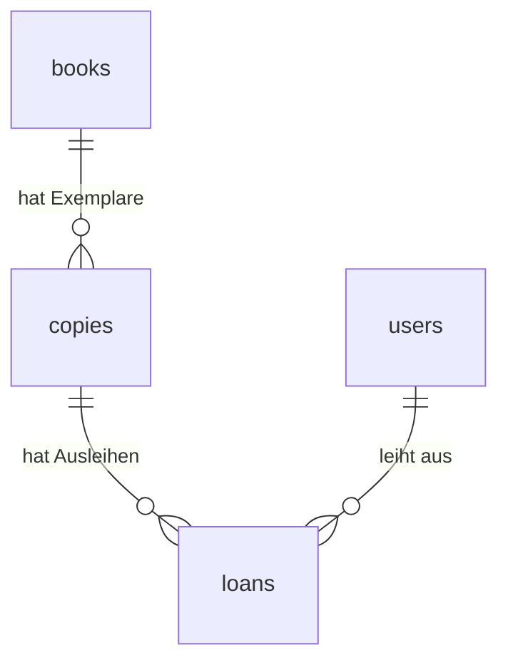

# Projektverlauf für die Präsentation

Hier halte ich die umgesetzten Schritte und ihre Gründe fest. Das hilft mir später bei der Demo.

## Die Grundlage

- Next.js, React und TypeScript bilden die Anwendung.
- PostgreSQL 18 läuft in Docker.
- pg verbindet den Next.js-Server mit der Datenbank.
- Die Zugangsdaten stehen in .env und .env.local. Diese Dateien werden nicht mit Git geteilt.
- Die Startseite liest eine Nachricht aus setup_check und zeigt sie an.
- setup-db.mjs führt die SQL-Dateien aus. Es zeigt keine gespeicherten Datensätze im Terminal an.

Für die Präsentation:

"Meine Webseite fragt die Datenbank auf dem Server ab. Die Nachricht auf der Seite kommt aus PostgreSQL und ist nicht einfach als fester Text in die Seite geschrieben."

## 21.10.2026: Tabellen für die Bibliotheksapp

### Was wurde gemacht?

books wurde erweitert; copies, users und loans wurden ergänzt. Die SQL-Befehle stehen in database/migrations/001_library_schema.sql. npm run db:setup führt sie nach der grundlegenden Einrichtung aus.

| Tabelle | Gespeicherte Angaben |
| --- | --- |
| books | ID, Titel, Autor, ISBN, Verlag, Erscheinungsjahr, Kategorie und Beschreibung |
| copies | ID, Inventarnummer, Buch-ID und Standort |
| users | ID, Name, E-Mail, Passwort-Hash und Rolle |
| loans | ID, Benutzer-ID, Exemplar-ID, Ausleihdatum, Fälligkeit und Rückgabedatum |

### Wie hängen die Tabellen zusammen?

Ein Buch beschreibt eine Ausgabe. Von dieser Ausgabe können mehrere Exemplare im Regal stehen. Jedes Exemplar hat eine eigene Inventarnummer. Eine Ausleihe verbindet einen Benutzer mit einem Exemplar.

### Was prüft die Datenbank?

- Jede Zeile hat eine eigene ID.
- Eine Ausleihe muss zu einem vorhandenen Benutzer und Exemplar gehören.
- Ein Exemplar muss zu einem vorhandenen Buch gehören.
- Eine eingetragene ISBN und jede Inventarnummer müssen eindeutig sein.
- Die gleiche E-Mail mit anderer Grossschreibung gilt ebenfalls als doppelt.
- Erlaubte Rollen sind user und admin.
- Pro Exemplar darf es nur eine aktive Ausleihe geben. Aktiv heisst: Das Rückgabedatum fehlt noch.
- Fälligkeit und Rückgabe dürfen nicht vor dem Ausleihdatum liegen.
- Verknüpfte Bücher, Benutzer oder Exemplare können nicht einfach gelöscht werden. Die Ausleihhistorie soll erhalten bleiben.

### Welche Begriffe gehören dazu?

- Primärschlüssel: die eindeutige ID einer Zeile.
- Fremdschlüssel: eine gespeicherte ID, die auf eine Zeile in einer anderen Tabelle verweist.
- Eindeutiger Index: eine Datenbankregel, die doppelte Werte verhindert.
- Transaktion: Mehrere Änderungen werden zusammen ausgeführt. Bei einem Fehler werden diese Änderungen zurückgenommen.

### Was wurde getestet?

16 Prüfungen in einem getrennten Testschema bestanden. Dazu gehörten die erneute Einrichtung, die Tabellenverbindungen, eindeutige Werte, Rollen, Datumsregeln und die Rückgabe mit erhaltener Historie. Eine zweite aktive Ausleihe desselben Exemplars wurde abgelehnt.

Die Testdaten wurden danach mit ROLLBACK entfernt. Anschliessend wurde das Schema in der eigentlichen Datenbank eingerichtet. Die vorhandene Testnachricht blieb erhalten. Zu diesem Zeitpunkt gab es dort 0 Bücher und 1 Testnachricht.

Nach der Rückkehr zu englischen Namen wurden die vorhandenen Datensätze mit Prüfsummen verglichen. Die Daten blieben erhalten und die englischen Abfragen funktionieren. Es gibt keine zusätzliche Datei für deutsche Namen.

### Was fehlte nach Schritt 1?

- Anmeldung und Prüfung der Benutzerrechte auf dem Server.
- Das sichere Erstellen von Passwort-Hashes. password_hash ist bisher nur die vorbereitete Spalte.
- Formulare für die zusätzlichen Buchfelder und deren Prüfung. Die neuen Felder sind vorerst optional, damit ältere Formulare funktionieren.
- Ausleihe und Rückgabe über die neuen Tabellen. books.borrowed bleibt vorerst für den alten Übungscode erhalten. Später kommt die Verfügbarkeit aus loans.
- Bestätigung der vorgeschlagenen Ausleihfrist von 30 Tagen.
- Vollständige Tests über die Webseite, darunter zwei gleichzeitige Ausleihanfragen.

Für die Präsentation:

"Ich habe Bücher und einzelne Exemplare getrennt. Dadurch kann ein Buch mehrere Exemplare haben. Eine Ausleihe verbindet einen Benutzer mit einem Exemplar. Die Datenbank verhindert zwei aktive Ausleihen desselben Exemplars. Die Anmeldung und die Oberfläche folgen in den nächsten Schritten."

## 21.10.2026: Anmeldung mit zwei Rollen

### Was wurde gemacht?

- Better Auth 1.7.12 wurde als Paket installiert. Es läuft in der Next.js-App und verwendet die PostgreSQL-Datenbank.
- /login enthält ein einfaches Formular mit E-Mail und Passwort. Bei einem Fehler erscheint eine kurze Meldung.
- Nach der Anmeldung zeigt die Startseite den Namen, die Rolle und weiterhin die Datenbanknachricht.
- Sign out beendet die Anmeldung.
- Die Rollen bleiben user (Benutzer) und admin (Verwaltung). Nur admin kann /admin öffnen.
- Eine öffentliche Registrierung und eine Benutzerverwaltung wurden noch nicht eingebaut. Für diesen Schritt gibt es zwei lokale Demo-Konten.

### Welche Dateien gehören dazu?

| Datei | Aufgabe |
| --- | --- |
| src/lib/auth.ts | Konfiguriert Better Auth und die vorhandenen Datenbanknamen |
| src/lib/auth-client.ts | Verbindet das Formular mit Better Auth |
| src/lib/require-user.ts | Prüft die Anmeldung und die Rolle auf dem Server |
| src/app/login/login-form.tsx | Liest E-Mail und Passwort und zeigt Fehler an |
| src/app/api/auth/[...all]/route.ts | Nimmt die Anfragen für die Anmeldung entgegen |
| src/app/logout-button.tsx | Meldet den Benutzer ab |
| database/migrations/002_authentication.sql | Ergänzt die Datenbank für Better Auth |
| scripts/create-demo-users.mjs | Erstellt fehlende lokale Testkonten |

### Was passiert beim Login?

1. Das Formular schickt E-Mail und Passwort an Better Auth auf dem Server.
2. Better Auth prüft das Passwort gegen den gespeicherten Hash. Das Klartextpasswort wird nicht in der Datenbank gespeichert.
3. Bei Erfolg legt Better Auth eine Sitzung an und setzt ein geschütztes Cookie.
4. Bei einem Seitenaufruf prüft der Server diese Sitzung.
5. Vor der Verwaltungsseite prüft requireAdmin zusätzlich die Rolle.

### Was wurde an der Datenbank geändert?

Die Benutzer bleiben in users und behalten ihre bisherigen IDs. Zusätzliche Felder speichern unter anderem, wann ein Benutzer angelegt wurde. auth_accounts enthält die Login-Methode und den Passwort-Hash. auth_sessions speichert die Sitzungen. auth_verifications ist eine zusätzliche Tabelle der Auth-Bibliothek; E-Mail-Bestätigung und Passwort-Zurücksetzen sind noch nicht eingerichtet.

Die alte Spalte users.password_hash bleibt bestehen, ist für neue Benutzer aber nicht mehr nötig. Der aktuelle Hash steht in auth_accounts.password_hash. Better Auth erstellt ihn mit seiner eingebauten scrypt-Funktion.

Die Demo-Konten heissen user@example.test und admin@example.test. Ihre Passwörter stehen nur in der ignorierten .env.local. Der Demo-Befehl überschreibt keine vorhandenen Konten oder Passwörter.

### Welche Prüfungen gibt es?

- Ein nicht angemeldeter Besucher wird zur Loginseite geschickt.
- Ein normaler Benutzer darf /admin auch mit einem direkt eingegebenen Link nicht öffnen.
- Die Rolle kann nicht über das Formular oder eine gefälschte Anfrage geändert werden.
- Eine Sitzung läuft nach acht Stunden ab. Nach dem Logout ist sie ungültig.
- Wiederholte Login-Versuche werden begrenzt. Die Begrenzung ist hier für einen lokalen Server eingerichtet.
- Better Auth prüft Cookies und lehnt Anfragen von einer nicht erlaubten Herkunft ab.
- Alle späteren Verwaltungsfunktionen müssen ihre Rechte ebenfalls auf dem Server prüfen. Ein versteckter Button reicht dafür nicht.

### Was wurde getestet?

22 Prüfungen über die laufende Anwendung bestanden: Login beider Rollen, falsches Passwort, geschützte Startseite, Zugriff auf /admin, Versuch einer eigenen Rollenänderung, gesperrte Registrierung, fremde Herkunft, Logout, verändertes Cookie, abgelaufene Sitzung und zu viele Login-Versuche. Die Loginseite wurde zusätzlich im Browser angesehen. Die Testnachricht ist nach dem Login weiter sichtbar.

Für die Präsentation:

"Für die Anmeldung nutze ich Better Auth. Die Bibliothek prüft das Passwort und verwaltet die Sitzung. Meine eigenen Funktionen prüfen auf dem Server, ob jemand angemeldet ist und ob er die Rolle admin hat. Ein Benutzer kann sich diese Rolle nicht selbst geben."

### Nächste Schritte

Nach diesem Schritt war die Anmeldung die Grundlage für Katalog, Benutzerverwaltung und Ausleihe. Die Verwaltungsseite diente zunächst zum Nachweis der Rechteprüfung. Die Buchverwaltung folgt im nächsten Eintrag.

## 21.10.2026: Bücher und Exemplare hinzufügen und bearbeiten

### Was wurde gemacht?

- Unter /admin/books gibt es eine Übersicht mit Titel, Autor, ISBN und Anzahl Exemplare.
- Add book öffnet ein einfaches Buchformular. Es speichert Titel, Autor, ISBN, Verlag, Erscheinungsjahr, Kategorie und Beschreibung.
- Nach dem Speichern kann die Verwaltung die Buchangaben bearbeiten und Exemplare hinzufügen.
- Jedes Exemplar hat eine eigene Inventarnummer und einen Standort. Die Angaben können beim zugehörigen Buch bearbeitet werden.
- Die Datenbanktabellen waren schon vorhanden. Dafür sind keine neue Migration und kein neues Paket nötig.
- IDs und Buchverbindungen bleiben beim Bearbeiten erhalten. Es gibt in diesem Schritt keine Löschfunktion und keine Ausleihfunktion.

### Wie funktioniert das Speichern?

1. Das Formular schickt seine Eingaben an eine Server Action in actions.ts.
2. requireAdmin prüft dort bei jeder Anfrage die Anmeldung und Rolle.
3. Der Server prüft Pflichtfelder, Textlängen, Erscheinungsjahr und eine eingetragene ISBN.
4. pg führt INSERT für neue Daten oder UPDATE für vorhandene Daten aus. Die Eingaben werden als SQL-Parameter übergeben.
5. Bei einem Fehler bleiben die Eingaben im Formular erhalten. Bei Erfolg wird die Bearbeitungsseite mit den gespeicherten Daten angezeigt.

Titel und Autor sind Pflichtfelder. Die weiteren Buchfelder bleiben vorerst optional. Für ein Exemplar sind Inventarnummer und Standort nötig. ISBN-10 und ISBN-13 werden mit ihrer Prüfziffer geprüft. Doppelte ISBNs und Inventarnummern verhindert zusätzlich die Datenbank.

### Was wurde getestet?

26 Prüfungen bestanden. Dazu gehören das Hinzufügen und Bearbeiten über die echten Browserformulare, der Vergleich mit den gespeicherten Daten, ungültige und doppelte ISBNs, doppelte Inventarnummern, erhaltene Eingaben nach einem Fehler und die Anzahl Exemplare in der Übersicht. Der Server lehnt auch einen Titel nur aus Leerzeichen und ein Erscheinungsjahr mit Nachkommastellen ab, wenn die Browserprüfung umgangen wird.

Nicht angemeldete Besucher und normale Benutzer können weder die Verwaltungsseiten öffnen noch die Speicherfunktionen für Bücher und Exemplare direkt aufrufen. Nicht vorhandene oder ungültige Buch-IDs ergeben eine 404-Seite. Im Browser gab es keine JavaScript-Fehler. Nur die eigens erzeugten Testbücher und Testexemplare wurden nach den Prüfungen entfernt. Die vorhandenen Daten blieben erhalten. Lint, TypeScript und Produktionsbuild bestanden ebenfalls.

### Welche Dateien gehören dazu?

- src/app/admin/books/page.tsx: Übersicht.
- src/app/admin/books/new/page.tsx: Neues Buch.
- src/app/admin/books/[id]/page.tsx: Buch und zugehörige Exemplare bearbeiten.
- book-form.tsx und copy-form.tsx: Die Formulare mit Fehlermeldungen und Speicherbutton.
- actions.ts: Rechte prüfen, Eingaben prüfen und SQL ausführen.
- src/lib/library-forms.ts: Datentypen und kleine Hilfsfunktionen.

Für die Präsentation:

"Ich speichere die Buchangaben einmal in books. Die einzelnen Bücher im Regal stehen als Exemplare in copies. Beim Speichern prüft mein Server zuerst die Verwaltungsrolle. Danach prüft er die Eingaben und speichert sie mit SQL. Ein normaler Benutzer darf diese Funktionen auch mit einer direkten Anfrage nicht ausführen."

## 21.10.2026: Benutzerverwaltung

### Was wurde gemacht?

- Unter Administration → Manage users sieht die Verwaltung Name, E-Mail und Rolle aller Benutzer.
- Add user erstellt ein Konto mit Name, E-Mail, Rolle und Anfangspasswort.
- Edit erlaubt Änderungen an Name, E-Mail und Rolle. Benutzer-ID und Passwort bleiben gleich.
- Neue Benutzer können sich direkt auf der vorhandenen Loginseite anmelden.
- Eine öffentliche Registrierung, Löschfunktion und Passwort-Zurücksetzen sind in diesem Schritt nicht enthalten.
- Die vorhandenen Tabellen und Pakete reichen aus. Eine neue Migration ist nicht nötig.

### Wie funktioniert das Anlegen?

1. Die Server Action prüft mit requireAdmin die Rolle und danach die Eingaben.
2. hashPassword aus Better Auth erstellt den Passwort-Hash. Es ist dieselbe Funktion wie im Demo-Skript.
3. Eine Transaktion erstellt den Benutzer in users und sein Passwortkonto in auth_accounts.
4. Bei einem Fehler wird die Transaktion zurückgenommen. Es bleibt kein halbfertiges Konto zurück.
5. Die Seite zeigt nur die sichtbaren Benutzerangaben. Passwort und Hash werden nicht zurückgegeben.

### Wie funktioniert das Bearbeiten?

Der Server prüft Name, E-Mail und Rolle und führt ein UPDATE aus. Doppelte E-Mail-Adressen werden abgelehnt. Bei einer Änderung von E-Mail oder Rolle werden die Sitzungen dieses Benutzers beendet. Danach muss er sich neu anmelden. Beim Ändern der E-Mail wird eine bisherige E-Mail-Bestätigung zurückgesetzt; ein Bestätigungsversand ist weiterhin nicht eingerichtet.

Die eigene Verwaltungsrolle kann nicht entfernt werden. Eine kurze Tabellensperre lässt jeweils nur eine Benutzeränderung zu. Anschliessend prüft der Server die Rolle der handelnden Person nochmals. Dadurch können zwei gleichzeitige Änderungen nicht dazu führen, dass sich zwei Verwaltungspersonen gegenseitig ihre Rechte entziehen.

### Welche Dateien gehören dazu?

- src/app/admin/users/page.tsx: Benutzerübersicht.
- src/app/admin/users/new/page.tsx: Benutzer anlegen.
- src/app/admin/users/[id]/page.tsx: Benutzer bearbeiten.
- src/app/admin/users/user-form.tsx: Eingabefelder und Fehlermeldungen.
- src/app/admin/users/actions.ts: Eingaben prüfen und Daten speichern.
- src/lib/user-forms.ts: Datentyp ohne Passwörter und Sitzungsdaten.

### Was wurde getestet?

41 Prüfungen bestanden. Über die echten Browserformulare wurde ein Benutzer angelegt. Name, E-Mail und Rolle wurden geändert; dabei wurde der Benutzer zur Verwaltung und zurück zum Benutzer gemacht. Das neue Konto konnte sich mit dem Anfangspasswort anmelden. Der Passwort-Hash blieb beim Bearbeiten gleich und wurde nicht an die Seite übertragen.

Auch Fehlerfälle wurden geprüft: zu kurzes Passwort, leerer Name, ungültige E-Mail, doppelte E-Mail bei Anlegen und Bearbeiten sowie eine gefälschte Rolle. Nach einem Fehler bleiben die normalen Eingaben erhalten, das Passwortfeld wird geleert. Normale Benutzer und nicht angemeldete Besucher können weder die Seiten öffnen noch die Speicherfunktionen direkt benutzen.

Änderungen an E-Mail und Rolle beenden die Sitzungen. Die eigene E-Mail konnte geändert werden; danach führte die App zur Loginseite und die Anmeldung mit der neuen Adresse funktionierte. Der Versuch, sich die eigene Verwaltungsrolle mit einer veränderten Anfrage zu entfernen, wurde abgelehnt. Ungültige und nicht vorhandene Benutzer-IDs ergaben eine 404-Seite. Im Browser gab es keine JavaScript-Fehler.

Die Testkonten wurden anschliessend entfernt. Name, E-Mail, Rolle und Passwort-Hash der bestehenden Demo-Konten wurden vor und nach dem Test verglichen und blieben gleich. Lint, TypeScript und Produktionsbuild bestanden. Zwei gleichzeitige Rollenänderungen wurden nicht praktisch nachgestellt; dafür ist die Sperre mit erneuter Rechteprüfung im Code vorhanden.

Für die Präsentation:

"Die Anmeldung war schon vorhanden. Jetzt kann die Verwaltung auf der Webseite neue Benutzer anlegen und ihre Angaben bearbeiten. Better Auth erstellt den Passwort-Hash. Mein eigener Code prüft die Verwaltungsrechte und speichert Benutzer und Passwortkonto zusammen in einer Transaktion. Wenn sich die Rolle ändert, wird der Benutzer abgemeldet und muss sich neu anmelden."

## 21.10.2026: Büchersuche nach Titel, Autor und ISBN

### Was wurde gemacht?

- Die Startseite hat den Link Search books zur Seite /books.
- Ein einfaches Suchfeld durchsucht Titel, Autor und ISBN. Teilbegriffe reichen aus.
- Die Suche ignoriert Gross- und Kleinschreibung. Für die ISBN werden Leerzeichen und Bindestriche aus dem Suchbegriff entfernt.
- Ein leeres Suchfeld zeigt den Katalog. Clear search leert das Feld und setzt die Adresse zurück.
- Die Ergebnisse zeigen Titel, Autor und ISBN. Nur die Verwaltung sieht einen Bearbeitungslink.
- Höchstens 100 Treffer werden angezeigt. Bei mehr Treffern erscheint ein Hinweis, genauer zu suchen. Ohne Treffer erscheint eine kurze Meldung.
- Die vorhandenen Tabellen und Pakete reichen aus. Die Startseite und src/app/books/page.tsx enthalten die Änderungen.

### Wie funktioniert die Suche?

1. Das HTML-Formular sendet eine GET-Anfrage, zum Beispiel /books?q=Harry.
2. Die Seite prüft mit requireUser die Anmeldung und liest q aus der Adresse.
3. Der Server entfernt Leerzeichen am Anfang und Ende und prüft die maximale Länge von 300 Zeichen.
4. Die SQL-Abfrage sucht mit POSITION nach dem Text. LOWER macht den Vergleich unabhängig von Gross- und Kleinschreibung. Ein Ergebnis grösser als null bedeutet, dass der Text vorkommt.
5. Die Eingaben werden mit SQL-Platzhaltern übergeben. Sie werden nicht als SQL-Befehle ausgeführt.
6. Die Ergebnisse werden nach Titel und ID sortiert und als Tabelle angezeigt.

### Was wurde getestet?

31 Prüfungen bestanden. Dazu gehören Titel- und Autorenteile, Gross- und Kleinschreibung, Umlaute, vollständige und teilweise ISBNs, ISBNs mit Leerzeichen und Bindestrichen, Prozentzeichen, Unterstriche und Apostrophe. Auch kein Treffer, Leerzeichen am Rand, zu lange Suchbegriffe, doppelte q-Parameter und die Begrenzung auf 100 Treffer wurden geprüft.

Das echte Suchformular wurde im Browser abgeschickt. Neuladen und Clear search funktionierten. Beide Rollen konnten suchen, nur die Verwaltung sah den funktionierenden Bearbeitungslink. Nicht angemeldete Besucher wurden zur Loginseite geleitet. Eingaben mit SQL- oder HTML-Text wurden als Text behandelt. Es gab keine JavaScript-Fehler im Browser.

Die Prüfungen nutzten eigens angelegte Testbücher. Diese wurden danach entfernt. Die bestehenden Buchdaten blieben unverändert; das wurde mit einer Prüfsumme verglichen. Lint, TypeScript und Produktionsbuild bestanden.

### Welche Art von Tests sind das?

Das sind Browser- und Integrationstests gegen die laufende App und die Datenbank. Unit-Tests würden einzelne Funktionen getrennt prüfen. Solche Tests und eine dauerhaft im Repository gespeicherte Testsuite gibt es bisher nicht. Die lokalen Prüfskripte wurden im temporären Ordner gestartet.

Für die Präsentation:

"Mein Suchformular schickt den Suchbegriff in der Adresse an den Server. Dort prüfe ich die Anmeldung und suche mit SQL in Titel, Autor und ISBN. Die Datenbank liefert die passenden Bücher. Ich brauche dafür keine eigene Suchbibliothek."

## 21.10.2026: Verfügbare Exemplare anzeigen

### Was wurde gemacht?

- Die Suchergebnisse zeigen verfügbare Exemplare und Gesamtzahl, zum Beispiel 2 of 4.
- Ein Klick auf den Buchtitel öffnet /books/[id]. Dort stehen die Buchangaben und alle Exemplare mit Inventarnummer, Standort und Status.
- Available bedeutet verfügbar. On loan bedeutet ausgeliehen.
- Ohne Exemplare oder ohne verfügbare Exemplare erscheint eine passende Meldung.
- Beide Rollen dürfen diese Seiten nach dem Anmelden sehen. Angaben zu den ausleihenden Personen werden nicht angezeigt.
- Die bestehenden Tabellen reichen aus. Es gibt kein neues Paket und keine Migration.

### Wie wird die Verfügbarkeit bestimmt?

Die SQL-Abfrage verbindet books mit copies und den aktiven loans. Aktiv ist eine Ausleihe, wenn returned_at leer ist. Gibt es für ein Exemplar keine solche Ausleihe, ist es verfügbar. Die Suchseite zählt diese Exemplare. Die Buchseite zeigt ihren Status und Standort.

Frühere Ausleihen mit einem Rückgabedatum werden nicht berücksichtigt. Dadurch bleibt ein zurückgegebenes Exemplar verfügbar, auch wenn es früher schon mehrmals ausgeliehen wurde. Eine überschrittene Frist allein macht ein Exemplar nicht wieder verfügbar. Es muss zuerst zurückgegeben werden. Das alte Feld books.borrowed wird nicht für die Berechnung verwendet.

Die Buchseite liest die Exemplare bei einem neuen Aufruf erneut. Eine Anzeige reserviert noch nichts. Die eigentliche Ausleihe mit erneuter Prüfung der Verfügbarkeit folgt in einem späteren Schritt.

### Was wurde geprüft?

22 gezielte Prüfungen bestanden: Bücher ohne Exemplare, vollständig ausgeliehene Bücher, gemischte Verfügbarkeit, ein noch nie ausgeliehenes Exemplar, mehrere abgeschlossene Ausleihen desselben Exemplars und eine überfällige aktive Ausleihe. Die Anzeige änderte sich nach einer Rückgabe in den Testdaten beim Neuladen korrekt. Suchübersicht und Buchseite zeigten passende Anzahlen.

Die Navigation im Browser, Standorte, beide Rollen, der Verwaltungslink und die Sperre für nicht angemeldete Besucher wurden ebenfalls geprüft. Ungültige und unbekannte Buch-IDs ergaben eine 404-Seite. Es wurden keine Angaben zu ausleihenden Personen angezeigt und keine JavaScript-Fehler gemeldet.

Die Prüfungen verwendeten nur eigens angelegte Bücher, Exemplare und Ausleihen. Diese Testdaten wurden danach entfernt. Die bestehenden Buch-, Exemplar- und Ausleihdaten blieben laut Prüfsummen unverändert. Lint, TypeScript und Produktionsbuild bestanden. Die dauerhafte Testsuite folgt am Ende.

Für die Präsentation:

"Ein Buch kann mehrere Exemplare haben. Ich prüfe für jedes Exemplar, ob es eine Ausleihe ohne Rückgabedatum gibt. Wenn nicht, ist es verfügbar. Deshalb muss ich keinen zweiten Verfügbarkeitswert speichern, der veralten könnte."

## 21.10.2026: Ausleihe mit Ausleihdatum und Rückgabefrist

### Was wurde gemacht?

- Verfügbare Exemplare haben auf der Buchseite den Button Borrow for 30 days.
- Der angemeldete Benutzer kann ein Exemplar für sich selbst ausleihen. Das gilt für beide Rollen.
- PostgreSQL speichert den Benutzer, das Exemplar, das aktuelle Ausleihdatum und eine Rückgabefrist von vorerst 30 Tagen.
- Nach dem Speichern öffnet sich My loans. Dort sieht jeder nur seine eigenen aktiven Ausleihen mit Inventarnummer und beiden Datumsangaben.
- Die Benutzer-ID und Datumswerte können nicht über das Formular vorgegeben werden.
- Die Tabellen waren schon vorbereitet. Es gibt kein neues Paket und keine neue Migration.
- Die Frist von 30 Tagen muss noch mit der Betreuung bestätigt werden. Die Rückgabe auf der Webseite folgt später.

### Was passiert beim Ausleihen?

1. Die Server Action borrowCopy prüft mit requireUser die Anmeldung und danach die Exemplar-ID.
2. BEGIN startet eine Transaktion auf einer Datenbankverbindung.
3. SELECT ... FOR UPDATE liest und sperrt das Exemplar für diese kurze Transaktion.
4. Der Server prüft, ob es eine Ausleihe ohne Rückgabedatum gibt. Falls ja, erscheint eine Meldung.
5. Falls das Exemplar verfügbar ist, erstellt INSERT eine neue Ausleihe. PostgreSQL setzt borrowed_at und due_at.
6. COMMIT speichert die Änderung und gibt die Sperre frei. Bei einem Fehler macht ROLLBACK die neue Änderung rückgängig.
7. Die Anwendung aktualisiert die betroffenen Seiten und öffnet My loans.

### Welcher Teil ist etwas anspruchsvoller?

Die kurze Transaktion und FOR UPDATE sind nötig, weil zwei Personen fast gleichzeitig auf Ausleihen klicken können. Die erste Anfrage sperrt das Exemplar. Die zweite wartet. Nach dem Speichern prüft die zweite Anfrage nochmals und erkennt die aktive Ausleihe. Zusätzlich verhindert die eindeutige Datenbankregel zwei aktive Ausleihen pro Exemplar. Der Button allein würde dafür nicht reichen.

Die Transaktion verwendet vom Beginn bis zum Abschluss dieselbe Datenbankverbindung. Mehrere getrennte pool.query-Aufrufe würden diese gemeinsame Transaktion nicht sicherstellen.

### Welche Dateien gehören dazu?

- src/app/books/borrow-actions.ts: Rechte prüfen, Exemplar sperren und Ausleihe speichern.
- src/app/books/borrow-button.tsx: Button, Wartezustand und Fehlermeldung.
- src/app/books/[id]/page.tsx: Zeigt den Button nur bei verfügbaren Exemplaren.
- src/app/loans/page.tsx: Liest nur die aktiven Ausleihen des angemeldeten Benutzers.
- src/app/page.tsx: Link zu My loans.

### Was wurde geprüft?

30 Prüfungen bestanden. Dazu gehören das Ausleihen über den echten Browserbutton, der gespeicherte Benutzer, das aktuelle Ausleihdatum, genau 30 Tage Frist und die Anzeige beider Daten. Eingeschleuste Benutzer-IDs und Datumsangaben wurden ignoriert. Eine nicht angemeldete Person konnte die Speicherfunktion auch mit einer direkten Anfrage nicht ausführen.

Eine bereits geöffnete Seite mit veraltetem Verfügbarkeitsstand und ein wiederholter direkter Aufruf erzeugten keine zweite Ausleihe. Zwei gleichzeitige Anfragen verschiedener Benutzer wurden mit einer kurz gehaltenen Testsperre gestartet: Genau eine war erfolgreich, die andere bekam die Meldung, dass das Exemplar schon ausgeliehen ist. In der Datenbank gab es danach genau eine aktive Ausleihe.

Beide Rollen konnten für sich selbst ausleihen. Fremde Ausleihen wurden auf My loans nicht angezeigt, auch nicht durch einen Benutzer-ID-Parameter in der Adresse. Eine abgeschlossene Testausleihe blieb erhalten und erschien nicht in der aktiven Liste. Ein danach gelöschtes Testexemplar führte beim erneuten Aufruf zu einer verständlichen Meldung. Es gab keine JavaScript-Fehler im Browser.

Alle erzeugten Testdaten wurden entfernt. Die bestehenden Buch-, Exemplar- und Ausleihdaten blieben laut Prüfsummen unverändert. Lint, TypeScript und Produktionsbuild bestanden. Die dauerhafte Testsuite folgt wie besprochen am Ende.

Für die Präsentation:

"Beim Ausleihen prüft mein Server die Anmeldung und sperrt das Exemplar kurz in einer Transaktion. Dann prüft er nochmals die Verfügbarkeit und speichert eine neue Ausleihe mit Datum und Frist. So können zwei Personen nicht dasselbe Exemplar gleichzeitig bekommen."

## 21.10.2026: Rückgabe durch die Verwaltung

### Was wurde gemacht?

- Unter Administration → Loans and returns sieht die Verwaltung alle aktiven Ausleihen.
- Die Tabelle zeigt Buch, Inventarnummer, Name und E-Mail der ausleihenden Person, Ausleihdatum und Rückgabefrist.
- Record return erfasst die Rückgabe nach dem Erhalt des Exemplars.
- PostgreSQL setzt das aktuelle Datum in returned_at. Die Ausleihe bleibt gespeichert.
- Das Exemplar wird wieder verfügbar und die abgeschlossene Ausleihe verschwindet aus den aktiven Listen.
- Normale Benutzer dürfen keine Rückgabe erfassen. Sowohl die Seite als auch die Server Action prüfen die Verwaltungsrolle.
- Die vorhandenen Tabellen und Pakete reichen aus. Die Ansicht der abgeschlossenen Historie folgt später.

### Wie funktioniert die Rückgabe?

1. Die Server Action returnLoan prüft mit requireAdmin die Rolle und danach die Ausleih-ID.
2. Ein UPDATE setzt returned_at auf CURRENT_TIMESTAMP, aber nur für eine Ausleihe ohne Rückgabedatum.
3. Die Datenbank gibt die Buch-ID zurück, damit die zugehörigen Seiten aktualisiert werden können.
4. Nach erfolgreichem Speichern erscheint wieder die Verwaltungsübersicht mit einer Bestätigung.

Hier reicht ein einzelner SQL-Befehl. Die Prüfung und Änderung passieren gemeinsam. Eine zusätzliche Transaktion mit mehreren Befehlen ist dafür nicht nötig. Bei zwei gleichzeitigen Rückgabeanfragen kann nur die erste eine noch aktive Zeile ändern. Die zweite erkennt, dass diese Ausleihe schon zurückgegeben wurde.

Benutzer, Exemplar, Ausleihdatum und Frist bleiben unverändert. Wird das Exemplar später erneut ausgeliehen, entsteht eine neue Ausleih-ID. Eine alte Rückgabeanfrage kann diese neue Ausleihe deshalb nicht beenden.

### Welche Dateien gehören dazu?

- src/app/admin/loans/page.tsx: Übersicht der aktiven Ausleihen für die Verwaltung.
- src/app/admin/loans/return-button.tsx: Rückgabebutton mit Wartezustand und Fehlermeldung.
- src/app/admin/loans/actions.ts: Rechte prüfen und Rückgabedatum speichern.
- src/app/admin/page.tsx: Link zur Rückgabeübersicht.
- src/app/books/borrow-actions.ts: Aktualisiert nach einer neuen Ausleihe auch die Verwaltungsübersicht.

### Was wurde geprüft?

31 gezielte Prüfungen bestanden. Der echte Rückgabebutton setzte das aktuelle Rückgabedatum. Ausleih-ID, Benutzer, Exemplar, Ausleihdatum und Frist blieben unverändert. Die abgeschlossene Ausleihe verschwand aus beiden aktiven Listen, blieb aber in der Datenbank erhalten. Die Suche zeigte das Exemplar danach wieder als verfügbar an.

Normale Benutzer und nicht angemeldete Besucher konnten weder die Verwaltungsseite öffnen noch die Rückgabefunktion direkt aufrufen. Eine veraltete Seite und ein doppelter Klick überschrieben das gespeicherte Rückgabedatum nicht. Bei zwei gleichzeitigen Rückgabeanfragen war genau eine erfolgreich; die andere erhielt eine Meldung.

Das zurückgegebene Exemplar konnte erneut ausgeliehen werden. Die neue Ausleihe erhielt eine neue ID und wurde durch eine alte Rückgabeanfrage nicht beendet. Sie konnte danach regulär zurückgegeben werden. Frühere abgeschlossene Ausleihen blieben unverändert. Fehlende Ausleihen und eine leere aktive Liste wurden ebenfalls geprüft. Es gab keine JavaScript-Fehler im Browser.

Nur eigens angelegte Testdaten wurden verändert und anschliessend entfernt. Die vorhandenen Buch-, Exemplar- und Ausleihdaten blieben laut Prüfsummen unverändert. Lint, TypeScript und Produktionsbuild bestanden. Die dauerhafte Testsuite folgt wie besprochen am Ende.

Für die Präsentation:

"Nur die Verwaltung darf eine Rückgabe erfassen. Ich lösche die Ausleihe nicht, sondern setze ihr Rückgabedatum. Dadurch wird das Exemplar wieder verfügbar und die Ausleihe bleibt für die Historie erhalten. Die Prüfung auf dem Server verhindert Rückgaben durch normale Benutzer."

## 21.10.2026: Eigene Ausleihen, Historie und überfällige Exemplare

### Was wurde gemacht?

- My loans zeigt weiterhin standardmässig die eigenen aktiven Ausleihen. Überfällige sind mit Overdue markiert.
- Overdue loans zeigt nur die eigenen überfälligen Ausleihen.
- Loan history zeigt eigene abgeschlossene Ausleihen mit Ausleihdatum, Frist und Rückgabedatum.
- Die Verwaltungsseite Loans and returns hat den Filter Overdue copies für alle überfälligen Exemplare.
- Die Verwaltung kann eine Rückgabe auch direkt aus der überfälligen Liste erfassen.
- Die beiden vorhandenen Seiten src/app/loans/page.tsx und src/app/admin/loans/page.tsx wurden erweitert. Neue Tabellen oder Pakete sind nicht nötig.

### Wann ist eine Ausleihe überfällig?

Eine Ausleihe ist aktuell überfällig, wenn returned_at leer ist und due_at vor CURRENT_TIMESTAMP liegt. Die Datenbank prüft das bei jedem Seitenaufruf. Dafür wird kein zusätzlicher Status gespeichert. Eine offene Seite muss neu geladen werden, um eine gerade abgelaufene Frist anzuzeigen.

Nach einer Rückgabe ist die Ausleihe abgeschlossen. Sie wird nicht weiter als aktuell überfällig angezeigt, auch wenn die damalige Frist überschritten war. In der Historie steht dann Returned mit dem gespeicherten Rückgabedatum. Aktive Ausleihen innerhalb der Frist heissen On loan.

### Wie bleiben fremde Ausleihen geschützt?

Alle persönlichen Abfragen verwenden weiterhin die Benutzer-ID aus der geprüften Sitzung. Der Ansichtsparameter wählt nur zwischen active, overdue und history. Er ändert nie den Benutzer. Unbekannte oder mehrfach angegebene Ansichten zeigen die aktive Liste. Die Übersicht aller überfälligen Exemplare prüft requireAdmin vor der Datenbankabfrage.

### Was wurde geprüft?

30 gezielte Prüfungen bestanden. Aktive Ausleihen innerhalb und ausserhalb der Frist, eigene Historie, alle drei Datumsangaben und die Statuswerte wurden geprüft. Eine verspätet zurückgegebene Ausleihe wurde korrekt als Returned statt Overdue angezeigt.

Normale Benutzer konnten keine fremde Historie und keine Verwaltungsübersicht lesen. Auch ein geänderter Benutzer-ID-Parameter gab keine fremden Daten frei. Nicht angemeldete Besucher wurden in allen persönlichen Ansichten zur Loginseite geschickt. Ungültige und doppelte Ansichtsparameter wurden sicher behandelt.

Die Verwaltung sah überfällige Exemplare verschiedener Benutzer, aber keine zurückgegebenen oder noch nicht fälligen Exemplare in diesem Filter. Nach einer echten Rückgabe im Browser verschwand das Exemplar aus beiden überfälligen Listen und erschien in der eigenen Historie. Eine in den Testdaten abgelaufene Frist wurde beim nächsten Aufruf ohne Hintergrunddienst erkannt. Die Links, Kennzeichnung der ausgewählten Ansicht und leere persönliche Überfälligkeitsliste funktionierten. Es gab keine JavaScript-Fehler im Browser.

Die eigens angelegten Testdaten wurden danach entfernt. Vorhandene Buch-, Exemplar- und Ausleihdaten blieben laut Prüfsummen unverändert. Lint, TypeScript und Produktionsbuild bestanden. Die dauerhafte Testsuite folgt wie besprochen am Ende.

Für die Präsentation:

"Jeder Benutzer sieht nur seine eigenen Ausleihen und früheren Rückgaben. Die Datenbank erkennt eine überfällige Ausleihe daran, dass die Frist vorbei ist und noch kein Rückgabedatum existiert. Die Verwaltung hat dafür eine eigene Liste und kann dort die Rückgabe erfassen."

## 21.10.2026: Eingaben und Benutzerrechte prüfen

### Was war bereits vorhanden?

- requireUser und requireAdmin schützen Seiten und Speicherfunktionen auf dem Server.
- Die Formulare prüfen Pflichtfelder, Textlängen, ISBN, Erscheinungsjahr, Passwörter und Rollen.
- Persönliche Ausleihlisten verwenden die Benutzer-ID aus der Sitzung.
- SQL-Platzhalter trennen Eingaben von SQL-Befehlen. Eindeutige Datenbankregeln verhindern doppelte Werte und doppelte aktive Ausleihen.
- Die eigene Verwaltungsrolle kann nicht entfernt werden. Eine Änderung von E-Mail oder Rolle beendet die betroffenen Sitzungen.

### Welche konkreten Lücken wurden gefunden und behoben?

1. Das Benutzerformular akzeptierte manche E-Mail-Adressen, die Better Auth beim Login ablehnt. Das wurde mit einem vorübergehenden Testkonto nachgestellt. validEmail in src/lib/user-forms.ts prüft jetzt ein mit dem installierten Login kompatibles Format. Die Prüfung gilt beim Anlegen und Bearbeiten.
2. Über den ungenutzten Auth-Endpunkt update-user konnte ein normaler Benutzer seinen eigenen Namen ändern und dabei die Namensprüfung umgehen. Auch ein Name nur aus Leerzeichen wurde angenommen. Der Endpunkt ist jetzt über disabledPaths in src/lib/auth.ts gesperrt. Die Änderung über das Verwaltungsformular bleibt möglich. Diese Lücke erlaubte keine eigene Vergabe der Verwaltungsrolle; das Rollenfeld war bereits geschützt.
3. Die Grenze von 32 Zeichen für die ISBN-Eingabe stand bisher nur im Browserformular. Der Server prüft diese Länge jetzt vor dem Entfernen von Bindestrichen und Leerzeichen.

Es wurden keine zusätzlichen Pakete, Tabellen oder allgemeinen Berechtigungsframeworks eingebaut. Die neue E-Mail-Prüfung besteht aus kleinen Prüfungen und zwei Textmustern. Die Muster sind etwas technischer, halten aber das Format mit dem bestehenden Login kompatibel. Die Prüfung sagt nicht, ob die Adresse tatsächlich existiert. Bestehende Benutzer, Rollen und Zugangsdaten wurden nicht automatisch verändert.

### Was wurde geprüft?

98 gezielte Prüfungen bestanden: 72 Eingabe- und Berechtigungsprüfungen sowie 26 erneute Prüfungen der Buch- und Exemplarformulare. Ungültige E-Mail-Formate wurden vor dem Speichern abgelehnt. Eine gültige Adresse mit Pluszeichen konnte angelegt werden und sich anmelden. Der gesperrte Profil-Endpunkt konnte weder Namen noch Rolle ändern. Das Verwaltungsformular zum Bearbeiten funktionierte weiterhin.

Alle vorhandenen geschützten Seiten wurden als Gast, normaler Benutzer und Verwaltung aufgerufen. Die erlaubten Seiten waren erreichbar, Verwaltungsseiten für normale Benutzer gesperrt und Gäste wurden zur Loginseite geschickt. Direkte unerlaubte Speicheranfragen, eine fremde Herkunft, ungültige ISBN-Länge, Pflichtfelder, ISBN-Prüfziffern, Erscheinungsjahr und doppelte ISBNs sowie Inventarnummern wurden geprüft. Die öffentliche Registrierung blieb gesperrt.

Die bestehenden Benutzer, Passwortkonten und Bücher blieben laut Prüfsummen unverändert. Die vorhandenen Konten hatten keine mit dem Login unvereinbaren E-Mail-Formate. Nur eigens angelegte Testdaten wurden danach entfernt. Es gab keine JavaScript-Fehler im Browser. Lint, TypeScript und Produktionsbuild bestanden. Die dauerhafte Testsuite folgt wie besprochen am Ende.

Für die Präsentation:

"Ich prüfe Eingaben und Rechte auf dem Server, weil Browserprüfungen und versteckte Buttons umgangen werden können. Die Benutzer-ID kommt aus der Anmeldung. Verwaltungsaktionen prüfen zusätzlich die Rolle. Die Datenbank verhindert ausserdem doppelte Werte und zwei aktive Ausleihen desselben Exemplars."

## 21.10.2026: Funktionen testen und Fehler beheben

Die dauerhaften Tests liegen jetzt im Repository. npm test startet 11 Unit-Tests für IDs, Textfelder, ISBNs und E-Mail-Adressen. npm run test:app startet 13 Browser- und Integrationstestfälle gegen die laufende App und PostgreSQL.

Der Testläufer gehört zu Node.js. Playwright 1.62.1 wurde nur als Entwicklungsabhängigkeit für die Browsersteuerung ergänzt. Die Anwendung selbst braucht kein neues Paket im normalen Betrieb. Alle Testkonten und Testdaten bekommen einen eindeutigen Namen und werden danach entfernt. Vorhandene Datensätze werden mit Prüfsummen verglichen.

Die Tests decken Anmeldung, Rechte, Bücher, Exemplare, Suche, Benutzerverwaltung, Ausleihe, Rückgabe, Historie und überfällige Ausleihen ab. Auch Rollenwechsel, gesperrte direkte Anfragen, doppelte Werte und zwei gleichzeitige Ausleihanfragen werden geprüft. Dafür sind Teile des Testcodes etwas anspruchsvoller als die Formulare der Anwendung.

Alle 11 Unit-Tests und 13 App-Testfälle bestanden. Lint, TypeScript und Produktionsbuild bestanden ebenfalls. In diesen Abläufen wurde kein weiterer Funktionsfehler gefunden. Im Testcode wurde sichergestellt, dass ein Speichervorgang vor einem Neuladen abgeschlossen ist. Die bisherigen einzelnen Prüfbedingungen aus den temporären Skripten sind nicht mit der Anzahl dieser Testfälle gleichzusetzen.

Die Testanleitung steht in der README. docs/testprotokoll.md enthält die Ergebnisse, Hinweise und offenen Punkte für die Präsentation. Frühere Einträge beschreiben jeweils den damaligen Stand vor dieser dauerhaften Testsuite.
