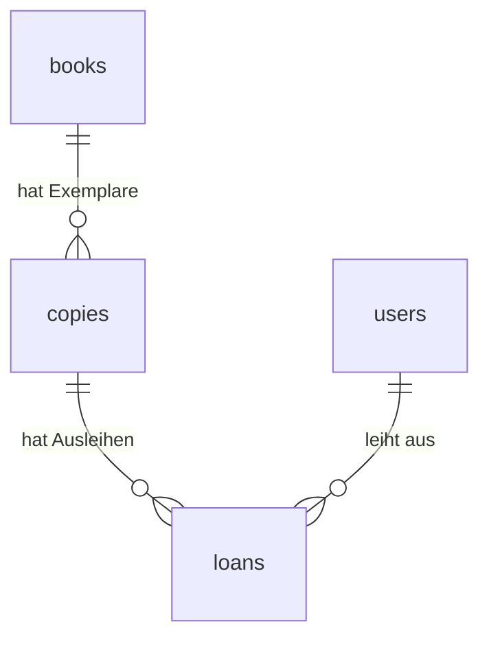

# Projektverlauf für die Präsentation

Hier halte ich die umgesetzten Schritte und ihre Gründe fest. Das hilft mir später bei der Demo.

## Die Grundlage

- Next.js, React und TypeScript bilden die Anwendung.
- PostgreSQL 18 läuft in Docker.
- pg verbindet den Next.js-Server mit der Datenbank.
- Die Zugangsdaten stehen in .env und .env.local. Diese Dateien werden nicht mit Git geteilt.
- Die Startseite liest eine Nachricht aus setup_check und zeigt sie an.
- setup-db.mjs führt die SQL-Dateien aus. Es zeigt keine gespeicherten Datensätze im Terminal an.

Für die Präsentation:

"Meine Webseite fragt die Datenbank auf dem Server ab. Die Nachricht auf der Seite kommt aus PostgreSQL und ist nicht einfach als fester Text in die Seite geschrieben."

## 21.10.2026: Tabellen für die Bibliotheksapp

### Was wurde gemacht?

books wurde erweitert; copies, users und loans wurden ergänzt. Die SQL-Befehle stehen in database/migrations/001_library_schema.sql. npm run db:setup führt sie nach der grundlegenden Einrichtung aus.

| Tabelle | Gespeicherte Angaben |
| --- | --- |
| books | ID, Titel, Autor, ISBN, Verlag, Erscheinungsjahr, Kategorie und Beschreibung |
| copies | ID, Inventarnummer, Buch-ID und Standort |
| users | ID, Name, E-Mail, Passwort-Hash und Rolle |
| loans | ID, Benutzer-ID, Exemplar-ID, Ausleihdatum, Fälligkeit und Rückgabedatum |

### Wie hängen die Tabellen zusammen?

Ein Buch beschreibt eine Ausgabe. Von dieser Ausgabe können mehrere Exemplare im Regal stehen. Jedes Exemplar hat eine eigene Inventarnummer. Eine Ausleihe verbindet einen Benutzer mit einem Exemplar.

### Was prüft die Datenbank?

- Jede Zeile hat eine eigene ID.
- Eine Ausleihe muss zu einem vorhandenen Benutzer und Exemplar gehören.
- Ein Exemplar muss zu einem vorhandenen Buch gehören.
- Eine eingetragene ISBN und jede Inventarnummer müssen eindeutig sein.
- Die gleiche E-Mail mit anderer Grossschreibung gilt ebenfalls als doppelt.
- Erlaubte Rollen sind user und admin.
- Pro Exemplar darf es nur eine aktive Ausleihe geben. Aktiv heisst: Das Rückgabedatum fehlt noch.
- Fälligkeit und Rückgabe dürfen nicht vor dem Ausleihdatum liegen.
- Verknüpfte Bücher, Benutzer oder Exemplare können nicht einfach gelöscht werden. Die Ausleihhistorie soll erhalten bleiben.

### Welche Begriffe gehören dazu?

- Primärschlüssel: die eindeutige ID einer Zeile.
- Fremdschlüssel: eine gespeicherte ID, die auf eine Zeile in einer anderen Tabelle verweist.
- Eindeutiger Index: eine Datenbankregel, die doppelte Werte verhindert.
- Transaktion: Mehrere Änderungen werden zusammen ausgeführt. Bei einem Fehler werden diese Änderungen zurückgenommen.

### Was wurde getestet?

16 Prüfungen in einem getrennten Testschema bestanden. Dazu gehörten die erneute Einrichtung, die Tabellenverbindungen, eindeutige Werte, Rollen, Datumsregeln und die Rückgabe mit erhaltener Historie. Eine zweite aktive Ausleihe desselben Exemplars wurde abgelehnt.

Die Testdaten wurden danach mit ROLLBACK entfernt. Anschliessend wurde das Schema in der eigentlichen Datenbank eingerichtet. Die vorhandene Testnachricht blieb erhalten. Zu diesem Zeitpunkt gab es dort 0 Bücher und 1 Testnachricht.

Nach der Rückkehr zu englischen Namen wurden die vorhandenen Datensätze mit Prüfsummen verglichen. Die Daten blieben erhalten und die englischen Abfragen funktionieren. Es gibt keine zusätzliche Datei für deutsche Namen.

### Was fehlte nach Schritt 1?

- Anmeldung und Prüfung der Benutzerrechte auf dem Server.
- Das sichere Erstellen von Passwort-Hashes. password_hash ist bisher nur die vorbereitete Spalte.
- Formulare für die zusätzlichen Buchfelder und deren Prüfung. Die neuen Felder sind vorerst optional, damit ältere Formulare funktionieren.
- Ausleihe und Rückgabe über die neuen Tabellen. books.borrowed bleibt vorerst für den alten Übungscode erhalten. Später kommt die Verfügbarkeit aus loans.
- Bestätigung der vorgeschlagenen Ausleihfrist von 30 Tagen.
- Vollständige Tests über die Webseite, darunter zwei gleichzeitige Ausleihanfragen.

Für die Präsentation:

"Ich habe Bücher und einzelne Exemplare getrennt. Dadurch kann ein Buch mehrere Exemplare haben. Eine Ausleihe verbindet einen Benutzer mit einem Exemplar. Die Datenbank verhindert zwei aktive Ausleihen desselben Exemplars. Die Anmeldung und die Oberfläche folgen in den nächsten Schritten."

## 21.10.2026: Anmeldung mit zwei Rollen

### Was wurde gemacht?

- Better Auth 1.7.12 wurde als Paket installiert. Es läuft in der Next.js-App und verwendet die PostgreSQL-Datenbank.
- /login enthält ein einfaches Formular mit E-Mail und Passwort. Bei einem Fehler erscheint eine kurze Meldung.
- Nach der Anmeldung zeigt die Startseite den Namen, die Rolle und weiterhin die Datenbanknachricht.
- Sign out beendet die Anmeldung.
- Die Rollen bleiben user (Benutzer) und admin (Verwaltung). Nur admin kann /admin öffnen.
- Eine öffentliche Registrierung und eine Benutzerverwaltung wurden noch nicht eingebaut. Für diesen Schritt gibt es zwei lokale Demo-Konten.

### Welche Dateien gehören dazu?

| Datei | Aufgabe |
| --- | --- |
| src/lib/auth.ts | Konfiguriert Better Auth und die vorhandenen Datenbanknamen |
| src/lib/auth-client.ts | Verbindet das Formular mit Better Auth |
| src/lib/require-user.ts | Prüft die Anmeldung und die Rolle auf dem Server |
| src/app/login/login-form.tsx | Liest E-Mail und Passwort und zeigt Fehler an |
| src/app/api/auth/[...all]/route.ts | Nimmt die Anfragen für die Anmeldung entgegen |
| src/app/logout-button.tsx | Meldet den Benutzer ab |
| database/migrations/002_authentication.sql | Ergänzt die Datenbank für Better Auth |
| scripts/create-demo-users.mjs | Erstellt fehlende lokale Testkonten |

### Was passiert beim Login?

1. Das Formular schickt E-Mail und Passwort an Better Auth auf dem Server.
2. Better Auth prüft das Passwort gegen den gespeicherten Hash. Das Klartextpasswort wird nicht in der Datenbank gespeichert.
3. Bei Erfolg legt Better Auth eine Sitzung an und setzt ein geschütztes Cookie.
4. Bei einem Seitenaufruf prüft der Server diese Sitzung.
5. Vor der Verwaltungsseite prüft requireAdmin zusätzlich die Rolle.

### Was wurde an der Datenbank geändert?

Die Benutzer bleiben in users und behalten ihre bisherigen IDs. Zusätzliche Felder speichern unter anderem, wann ein Benutzer angelegt wurde. auth_accounts enthält die Login-Methode und den Passwort-Hash. auth_sessions speichert die Sitzungen. auth_verifications ist eine zusätzliche Tabelle der Auth-Bibliothek; E-Mail-Bestätigung und Passwort-Zurücksetzen sind noch nicht eingerichtet.

Die alte Spalte users.password_hash bleibt bestehen, ist für neue Benutzer aber nicht mehr nötig. Der aktuelle Hash steht in auth_accounts.password_hash. Better Auth erstellt ihn mit seiner eingebauten scrypt-Funktion.

Die Demo-Konten heissen user@example.test und admin@example.test. Ihre Passwörter stehen nur in der ignorierten .env.local. Der Demo-Befehl überschreibt keine vorhandenen Konten oder Passwörter.

### Welche Prüfungen gibt es?

- Ein nicht angemeldeter Besucher wird zur Loginseite geschickt.
- Ein normaler Benutzer darf /admin auch mit einem direkt eingegebenen Link nicht öffnen.
- Die Rolle kann nicht über das Formular oder eine gefälschte Anfrage geändert werden.
- Eine Sitzung läuft nach acht Stunden ab. Nach dem Logout ist sie ungültig.
- Wiederholte Login-Versuche werden begrenzt. Die Begrenzung ist hier für einen lokalen Server eingerichtet.
- Better Auth prüft Cookies und lehnt Anfragen von einer nicht erlaubten Herkunft ab.
- Alle späteren Verwaltungsfunktionen müssen ihre Rechte ebenfalls auf dem Server prüfen. Ein versteckter Button reicht dafür nicht.

### Was wurde getestet?

22 Prüfungen über die laufende Anwendung bestanden: Login beider Rollen, falsches Passwort, geschützte Startseite, Zugriff auf /admin, Versuch einer eigenen Rollenänderung, gesperrte Registrierung, fremde Herkunft, Logout, verändertes Cookie, abgelaufene Sitzung und zu viele Login-Versuche. Die Loginseite wurde zusätzlich im Browser angesehen. Die Testnachricht ist nach dem Login weiter sichtbar.

Für die Präsentation:

"Für die Anmeldung nutze ich Better Auth. Die Bibliothek prüft das Passwort und verwaltet die Sitzung. Meine eigenen Funktionen prüfen auf dem Server, ob jemand angemeldet ist und ob er die Rolle admin hat. Ein Benutzer kann sich diese Rolle nicht selbst geben."

### Nächste Schritte

Nach diesem Schritt war die Anmeldung die Grundlage für Katalog, Benutzerverwaltung und Ausleihe. Die Verwaltungsseite diente zunächst zum Nachweis der Rechteprüfung. Die Buchverwaltung folgt im nächsten Eintrag.

## 21.10.2026: Bücher und Exemplare hinzufügen und bearbeiten

### Was wurde gemacht?

- Unter /admin/books gibt es eine Übersicht mit Titel, Autor, ISBN und Anzahl Exemplare.
- Add book öffnet ein einfaches Buchformular. Es speichert Titel, Autor, ISBN, Verlag, Erscheinungsjahr, Kategorie und Beschreibung.
- Nach dem Speichern kann die Verwaltung die Buchangaben bearbeiten und Exemplare hinzufügen.
- Jedes Exemplar hat eine eigene Inventarnummer und einen Standort. Die Angaben können beim zugehörigen Buch bearbeitet werden.
- Die Datenbanktabellen waren schon vorhanden. Dafür sind keine neue Migration und kein neues Paket nötig.
- IDs und Buchverbindungen bleiben beim Bearbeiten erhalten. Es gibt in diesem Schritt keine Löschfunktion und keine Ausleihfunktion.

### Wie funktioniert das Speichern?

1. Das Formular schickt seine Eingaben an eine Server Action in actions.ts.
2. requireAdmin prüft dort bei jeder Anfrage die Anmeldung und Rolle.
3. Der Server prüft Pflichtfelder, Textlängen, Erscheinungsjahr und eine eingetragene ISBN.
4. pg führt INSERT für neue Daten oder UPDATE für vorhandene Daten aus. Die Eingaben werden als SQL-Parameter übergeben.
5. Bei einem Fehler bleiben die Eingaben im Formular erhalten. Bei Erfolg wird die Bearbeitungsseite mit den gespeicherten Daten angezeigt.

Titel und Autor sind Pflichtfelder. Die weiteren Buchfelder bleiben vorerst optional. Für ein Exemplar sind Inventarnummer und Standort nötig. ISBN-10 und ISBN-13 werden mit ihrer Prüfziffer geprüft. Doppelte ISBNs und Inventarnummern verhindert zusätzlich die Datenbank.

### Was wurde getestet?

26 Prüfungen bestanden. Dazu gehören das Hinzufügen und Bearbeiten über die echten Browserformulare, der Vergleich mit den gespeicherten Daten, ungültige und doppelte ISBNs, doppelte Inventarnummern, erhaltene Eingaben nach einem Fehler und die Anzahl Exemplare in der Übersicht. Der Server lehnt auch einen Titel nur aus Leerzeichen und ein Erscheinungsjahr mit Nachkommastellen ab, wenn die Browserprüfung umgangen wird.

Nicht angemeldete Besucher und normale Benutzer können weder die Verwaltungsseiten öffnen noch die Speicherfunktionen für Bücher und Exemplare direkt aufrufen. Nicht vorhandene oder ungültige Buch-IDs ergeben eine 404-Seite. Im Browser gab es keine JavaScript-Fehler. Nur die eigens erzeugten Testbücher und Testexemplare wurden nach den Prüfungen entfernt. Die vorhandenen Daten blieben erhalten. Lint, TypeScript und Produktionsbuild bestanden ebenfalls.

### Welche Dateien gehören dazu?

- src/app/admin/books/page.tsx: Übersicht.
- src/app/admin/books/new/page.tsx: Neues Buch.
- src/app/admin/books/[id]/page.tsx: Buch und zugehörige Exemplare bearbeiten.
- book-form.tsx und copy-form.tsx: Die Formulare mit Fehlermeldungen und Speicherbutton.
- actions.ts: Rechte prüfen, Eingaben prüfen und SQL ausführen.
- src/lib/library-forms.ts: Datentypen und kleine Hilfsfunktionen.

Für die Präsentation:

"Ich speichere die Buchangaben einmal in books. Die einzelnen Bücher im Regal stehen als Exemplare in copies. Beim Speichern prüft mein Server zuerst die Verwaltungsrolle. Danach prüft er die Eingaben und speichert sie mit SQL. Ein normaler Benutzer darf diese Funktionen auch mit einer direkten Anfrage nicht ausführen."

## 21.10.2026: Benutzerverwaltung

### Was wurde gemacht?

- Unter Administration → Manage users sieht die Verwaltung Name, E-Mail und Rolle aller Benutzer.
- Add user erstellt ein Konto mit Name, E-Mail, Rolle und Anfangspasswort.
- Edit erlaubt Änderungen an Name, E-Mail und Rolle. Benutzer-ID und Passwort bleiben gleich.
- Neue Benutzer können sich direkt auf der vorhandenen Loginseite anmelden.
- Eine öffentliche Registrierung, Löschfunktion und Passwort-Zurücksetzen sind in diesem Schritt nicht enthalten.
- Die vorhandenen Tabellen und Pakete reichen aus. Eine neue Migration ist nicht nötig.

### Wie funktioniert das Anlegen?

1. Die Server Action prüft mit requireAdmin die Rolle und danach die Eingaben.
2. hashPassword aus Better Auth erstellt den Passwort-Hash. Es ist dieselbe Funktion wie im Demo-Skript.
3. Eine Transaktion erstellt den Benutzer in users und sein Passwortkonto in auth_accounts.
4. Bei einem Fehler wird die Transaktion zurückgenommen. Es bleibt kein halbfertiges Konto zurück.
5. Die Seite zeigt nur die sichtbaren Benutzerangaben. Passwort und Hash werden nicht zurückgegeben.

### Wie funktioniert das Bearbeiten?

Der Server prüft Name, E-Mail und Rolle und führt ein UPDATE aus. Doppelte E-Mail-Adressen werden abgelehnt. Bei einer Änderung von E-Mail oder Rolle werden die Sitzungen dieses Benutzers beendet. Danach muss er sich neu anmelden. Beim Ändern der E-Mail wird eine bisherige E-Mail-Bestätigung zurückgesetzt; ein Bestätigungsversand ist weiterhin nicht eingerichtet.

Die eigene Verwaltungsrolle kann nicht entfernt werden. Eine kurze Tabellensperre lässt jeweils nur eine Benutzeränderung zu. Anschliessend prüft der Server die Rolle der handelnden Person nochmals. Dadurch können zwei gleichzeitige Änderungen nicht dazu führen, dass sich zwei Verwaltungspersonen gegenseitig ihre Rechte entziehen.

### Welche Dateien gehören dazu?

- src/app/admin/users/page.tsx: Benutzerübersicht.
- src/app/admin/users/new/page.tsx: Benutzer anlegen.
- src/app/admin/users/[id]/page.tsx: Benutzer bearbeiten.
- src/app/admin/users/user-form.tsx: Eingabefelder und Fehlermeldungen.
- src/app/admin/users/actions.ts: Eingaben prüfen und Daten speichern.
- src/lib/user-forms.ts: Datentyp ohne Passwörter und Sitzungsdaten.

### Was wurde getestet?

41 Prüfungen bestanden. Über die echten Browserformulare wurde ein Benutzer angelegt. Name, E-Mail und Rolle wurden geändert; dabei wurde der Benutzer zur Verwaltung und zurück zum Benutzer gemacht. Das neue Konto konnte sich mit dem Anfangspasswort anmelden. Der Passwort-Hash blieb beim Bearbeiten gleich und wurde nicht an die Seite übertragen.

Auch Fehlerfälle wurden geprüft: zu kurzes Passwort, leerer Name, ungültige E-Mail, doppelte E-Mail bei Anlegen und Bearbeiten sowie eine gefälschte Rolle. Nach einem Fehler bleiben die normalen Eingaben erhalten, das Passwortfeld wird geleert. Normale Benutzer und nicht angemeldete Besucher können weder die Seiten öffnen noch die Speicherfunktionen direkt benutzen.

Änderungen an E-Mail und Rolle beenden die Sitzungen. Die eigene E-Mail konnte geändert werden; danach führte die App zur Loginseite und die Anmeldung mit der neuen Adresse funktionierte. Der Versuch, sich die eigene Verwaltungsrolle mit einer veränderten Anfrage zu entfernen, wurde abgelehnt. Ungültige und nicht vorhandene Benutzer-IDs ergaben eine 404-Seite. Im Browser gab es keine JavaScript-Fehler.

Die Testkonten wurden anschliessend entfernt. Name, E-Mail, Rolle und Passwort-Hash der bestehenden Demo-Konten wurden vor und nach dem Test verglichen und blieben gleich. Lint, TypeScript und Produktionsbuild bestanden. Zwei gleichzeitige Rollenänderungen wurden nicht praktisch nachgestellt; dafür ist die Sperre mit erneuter Rechteprüfung im Code vorhanden.

Für die Präsentation:

"Die Anmeldung war schon vorhanden. Jetzt kann die Verwaltung auf der Webseite neue Benutzer anlegen und ihre Angaben bearbeiten. Better Auth erstellt den Passwort-Hash. Mein eigener Code prüft die Verwaltungsrechte und speichert Benutzer und Passwortkonto zusammen in einer Transaktion. Wenn sich die Rolle ändert, wird der Benutzer abgemeldet und muss sich neu anmelden."
