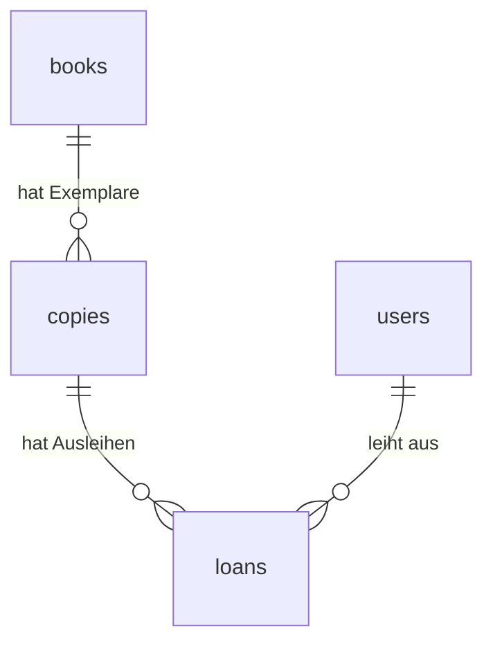

# Projektverlauf für die Präsentation

Hier halte ich die umgesetzten Schritte und ihre Gründe fest. Das hilft mir später bei der Demo.

## Die Grundlage

- Next.js, React und TypeScript bilden die Anwendung.
- PostgreSQL 18 läuft in Docker.
- pg verbindet den Next.js-Server mit der Datenbank.
- Die Zugangsdaten stehen in .env und .env.local. Diese Dateien werden nicht mit Git geteilt.
- Die Startseite liest eine Nachricht aus setup_check und zeigt sie an.
- setup-db.mjs führt die SQL-Dateien aus. Es zeigt keine gespeicherten Datensätze im Terminal an.

Für die Präsentation:

"Meine Webseite fragt die Datenbank auf dem Server ab. Die Nachricht auf der Seite kommt aus PostgreSQL und ist nicht einfach als fester Text in die Seite geschrieben."

## 21.10.2026: Tabellen für die Bibliotheksapp

### Was wurde gemacht?

books wurde erweitert; copies, users und loans wurden ergänzt. Die SQL-Befehle stehen in database/migrations/001_library_schema.sql. npm run db:setup führt sie nach der grundlegenden Einrichtung aus.

| Tabelle | Gespeicherte Angaben |
| --- | --- |
| books | ID, Titel, Autor, ISBN, Verlag, Erscheinungsjahr, Kategorie und Beschreibung |
| copies | ID, Inventarnummer, Buch-ID und Standort |
| users | ID, Name, E-Mail, Passwort-Hash und Rolle |
| loans | ID, Benutzer-ID, Exemplar-ID, Ausleihdatum, Fälligkeit und Rückgabedatum |

### Wie hängen die Tabellen zusammen?

Ein Buch beschreibt eine Ausgabe. Von dieser Ausgabe können mehrere Exemplare im Regal stehen. Jedes Exemplar hat eine eigene Inventarnummer. Eine Ausleihe verbindet einen Benutzer mit einem Exemplar.

### Was prüft die Datenbank?

- Jede Zeile hat eine eigene ID.
- Eine Ausleihe muss zu einem vorhandenen Benutzer und Exemplar gehören.
- Ein Exemplar muss zu einem vorhandenen Buch gehören.
- Eine eingetragene ISBN und jede Inventarnummer müssen eindeutig sein.
- Die gleiche E-Mail mit anderer Grossschreibung gilt ebenfalls als doppelt.
- Erlaubte Rollen sind user und admin.
- Pro Exemplar darf es nur eine aktive Ausleihe geben. Aktiv heisst: Das Rückgabedatum fehlt noch.
- Fälligkeit und Rückgabe dürfen nicht vor dem Ausleihdatum liegen.
- Verknüpfte Bücher, Benutzer oder Exemplare können nicht einfach gelöscht werden. Die Ausleihhistorie soll erhalten bleiben.

### Welche Begriffe gehören dazu?

- Primärschlüssel: die eindeutige ID einer Zeile.
- Fremdschlüssel: eine gespeicherte ID, die auf eine Zeile in einer anderen Tabelle verweist.
- Eindeutiger Index: eine Datenbankregel, die doppelte Werte verhindert.
- Transaktion: Mehrere Änderungen werden zusammen ausgeführt. Bei einem Fehler werden diese Änderungen zurückgenommen.

### Was wurde getestet?

16 Prüfungen in einem getrennten Testschema bestanden. Dazu gehörten die erneute Einrichtung, die Tabellenverbindungen, eindeutige Werte, Rollen, Datumsregeln und die Rückgabe mit erhaltener Historie. Eine zweite aktive Ausleihe desselben Exemplars wurde abgelehnt.

Die Testdaten wurden danach mit ROLLBACK entfernt. Anschliessend wurde das Schema in der eigentlichen Datenbank eingerichtet. Die vorhandene Testnachricht blieb erhalten. Zu diesem Zeitpunkt gab es dort 0 Bücher und 1 Testnachricht.

Nach der Rückkehr zu englischen Namen wurden die vorhandenen Datensätze mit Prüfsummen verglichen. Die Daten blieben erhalten und die englischen Abfragen funktionieren. Es gibt keine zusätzliche Datei für deutsche Namen.

### Was fehlt noch?

- Anmeldung und Prüfung der Benutzerrechte auf dem Server.
- Das sichere Erstellen von Passwort-Hashes. password_hash ist bisher nur die vorbereitete Spalte.
- Formulare für die zusätzlichen Buchfelder und deren Prüfung. Die neuen Felder sind vorerst optional, damit ältere Formulare funktionieren.
- Ausleihe und Rückgabe über die neuen Tabellen. books.borrowed bleibt vorerst für den alten Übungscode erhalten. Später kommt die Verfügbarkeit aus loans.
- Bestätigung der vorgeschlagenen Ausleihfrist von 30 Tagen.
- Vollständige Tests über die Webseite, darunter zwei gleichzeitige Ausleihanfragen.

Für die Präsentation:

"Ich habe Bücher und einzelne Exemplare getrennt. Dadurch kann ein Buch mehrere Exemplare haben. Eine Ausleihe verbindet einen Benutzer mit einem Exemplar. Die Datenbank verhindert zwei aktive Ausleihen desselben Exemplars. Die Anmeldung und die Oberfläche folgen in den nächsten Schritten."
